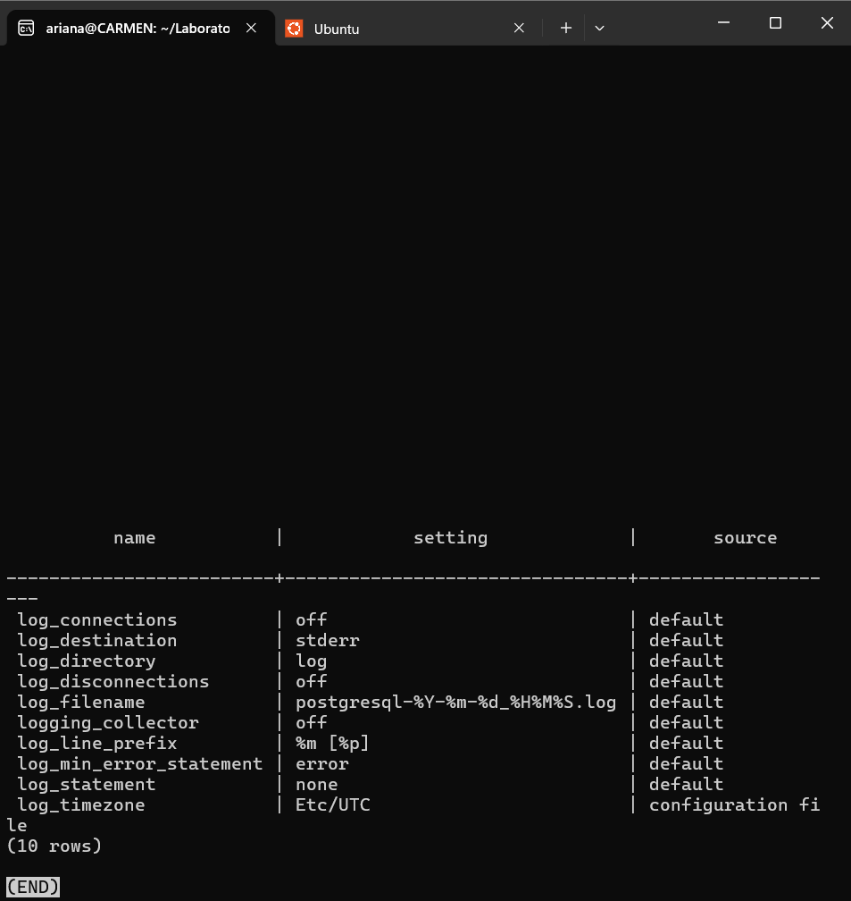

## Actividad 1 — Configuración de registro por defecto

**Estudiante:** Carmen Ariana Salazar Bojórquez 

**Comando ejecutado:**
```sql
SELECT name, setting, source
FROM pg_settings
WHERE name IN ('log_destination', 'logging_collector', 'log_directory', 'log_filename',
               'log_connections', 'log_disconnections', 'log_line_prefix',
               'log_statement', 'log_min_error_statement', 'log_timezone')
ORDER BY name;
```

**Resultado obtenido:**
```

```


**PREGUNTAS**
**1. Con esta configuración, ¿se registra quién se conecta?**
No. `log_connections = off` y `log_disconnections = off` (ambos con `source = default`), por lo que el servidor no escribe en la bitácora ni las conexiones ni las desconexiones. No queda constancia de qué rol entró, cuándo ni cuánto duró su sesión.

**2. ¿Se registran las sentencias UPDATE?**
No. `log_statement = none` (`source = default`), así que ninguna sentencia SQL se registra por ser ejecutada. Solo quedarían las sentencias que provocan un error, porque `log_min_error_statement = error`, y un UPDATE exitoso no genera error.

**3. ¿La línea de bitácora incluye el usuario o la dirección IP del cliente?**
No. `log_line_prefix = %m [%p]` solo agrega la marca de tiempo con milisegundos (`%m`) y el PID del proceso (`%p`). Faltan `%u` (usuario), `%d` (base de datos), `%a` (aplicación) y `%h` (host o IP del cliente). Aunque se registrara un evento, no se podría saber quién lo originó ni desde dónde.

**4. ¿En qué zona horaria se registran los eventos? ¿Por qué importa al reconstruir una cronología?**
En `Etc/UTC` (`log_timezone`, definido en el archivo de configuración). Importa porque una cronología combina fuentes: la bitácora del servidor, la tabla de auditoría (`TIMESTAMPTZ`), la hora del equipo del analista (en mi caso UTC-7) y reportes de otras áreas. Si no se sabe que la bitácora está en UTC, un evento puede parecer ocurrido horas antes o después de lo real, y se podría ordenar mal o atribuir a una persona o turno equivocado.

**5. Con `logging_collector = off`, ¿quién decide dónde termina la bitácora: PostgreSQL o el mecanismo con que se desplegó el servidor?**
El mecanismo de despliegue. Con el colector apagado, PostgreSQL solo escribe a `stderr` (`log_destination = stderr`) y no administra archivos propios. Lo que ocurra con esa salida depende de cómo se lanzó el servicio: en este laboratorio, el contenedor Docker la captura y la expone con `docker logs`; en otro despliegue iría a `journald`, a un archivo del servicio, etc. La evidencia queda fuera del control del servidor, y puede rotarse o perderse sin que PostgreSQL intervenga.
