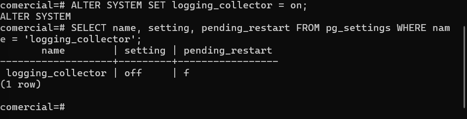
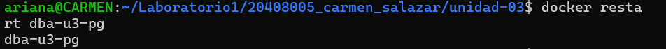
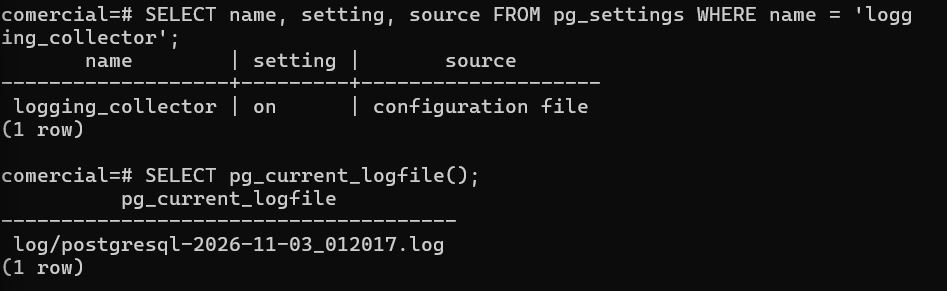
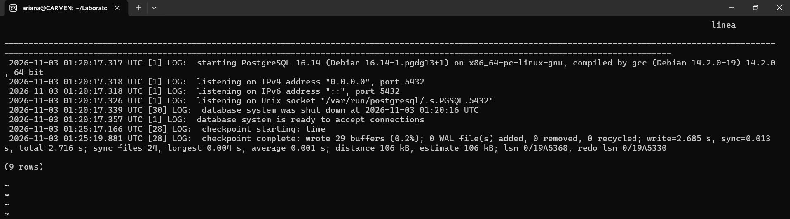
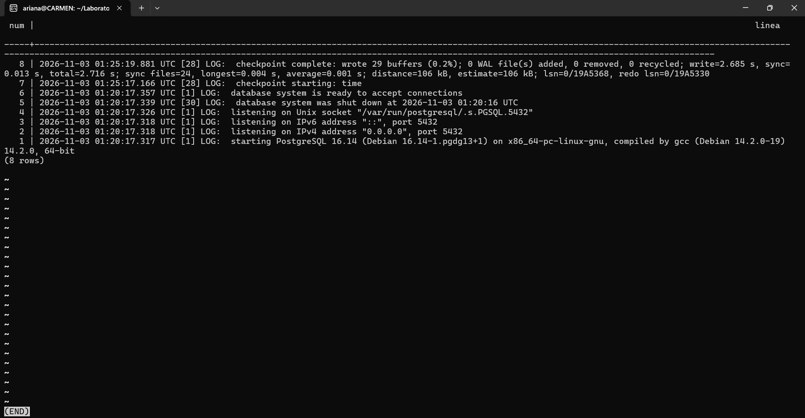

# Evidencia 02 — Colector de bitácora y vista dba.bitacora

**Estudiante:** Carmen Ariana Salazar Bojórquez 
**Actividad:** 2

## Activación del colector
**Comando:** `ALTER SYSTEM SET logging_collector = on;`
**Estado antes del reinicio (pending_restart):**

## Reinicio
**Comando:** `docker restart dba-u3-pg`

## Verificación

## Lectura de la bitácora desde el motor

## Vista dba.bitacora
**Comando:** ver `sql/01-colector-y-vista.sql`
**Prueba (últimas 10 líneas):**

## Preguntas

## 1. ¿Por qué `logging_collector` requiere reinicio y `log_statement` solo recarga?

Esto se debe a que `logging_collector` y `log_statement` tienen distintos niveles de aplicación. `logging_collector` requiere reiniciar PostgreSQL porque activa un proceso interno encargado de recopilar y escribir los mensajes en archivos de registro. En cambio, `log_statement` solo necesita una recarga de configuración porque modifica el tipo de instrucciones SQL que se registran y este cambio puede aplicarse sin detener el servidor.

## 2. ¿Qué ventaja tiene leer la bitácora con SQL y no con una herramienta del sistema operativo o del contenedor? ¿Qué riesgo introduce?

La ventaja de leer la bitácora mediante SQL es que permite consultar, filtrar, ordenar y analizar los registros directamente desde PostgreSQL, sin necesidad de salir de la base de datos. También facilita la automatización de consultas y el análisis de eventos.

Sin embargo, introduce riesgos de seguridad porque los registros pueden contener información sensible, como nombres de usuarios, consultas SQL y datos de la actividad de la base de datos. Además, algunas funciones para consultar archivos requieren privilegios elevados y las consultas sobre grandes cantidades de registros pueden consumir recursos del servidor.

## 3. ¿Quién debería poder consultar `dba.bitacora`?

Únicamente el personal autorizado que tenga responsabilidades de administración, seguridad y auditoría de la base de datos. Por ejemplo, el DBA y el personal de seguridad encargado de revisar los eventos y detectar actividades sospechosas. Los usuarios comunes no deberían tener acceso, ya que la bitácora puede contener información sensible sobre las operaciones y los usuarios del sistema. Se deben asignar permisos mínimos necesarios para proteger la confidencialidad de la información.
