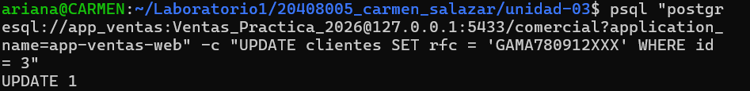
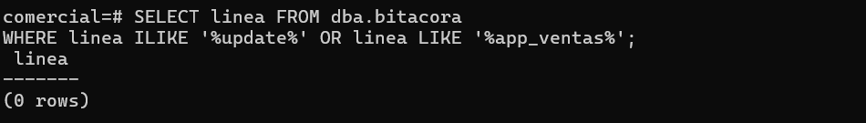
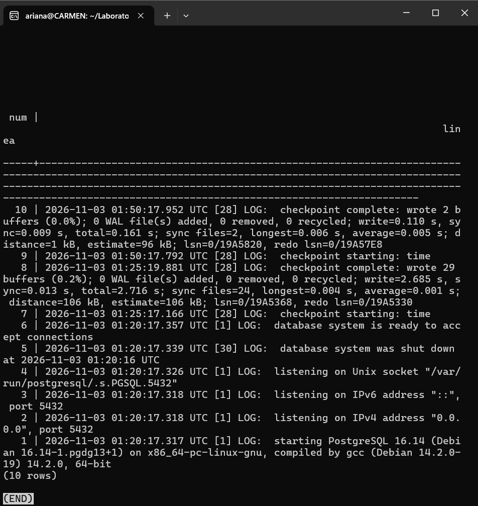
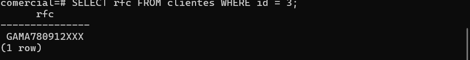

## Actividad 3
**Alumna** Carmen Ariana Salazar Bojórquez


```bash
psql "postgresql://app_ventas:<REDACTED>@127.0.0.1:5433/comercial?application_name=app-ventas-web" -c "UPDATE clientes SET rfc = 'GAMA780912XXX' WHERE id = 3"
```
**Resultado:**


## Búsqueda de evidencia (sesión de administrador)
**Comando:**
```sql
SELECT linea FROM dba.bitacora
WHERE linea ILIKE '%update%' OR linea LIKE '%app_ventas%';
```
**Resultado:**


**Contenido real de la bitácora (últimas 10 líneas):**




## Preguntas

**1. ¿Puedes demostrar quién modificó el RFC?**
No. La consulta a `dba.bitacora` devolvió `(0 rows)`: no hay registro del `UPDATE` ni de la conexión de `app_ventas`. Lo único que puedo demostrar es que el RFC de María García (id = 3) cambió, porque el valor actual es `GAMA780912XXX`, pero no quién lo hizo, cuándo, desde qué aplicación o equipo, ni cuál era el valor anterior. Esto es consecuencia de la configuración por defecto: `log_connections = off` (no se registran las conexiones), `log_statement = none` (no se registran las sentencias) y un `log_line_prefix` que no incluye usuario ni IP. Además, la tabla `clientes` solo guarda el valor actual, no el historial.

**2. ¿Puedes demostrar que el cambio no lo hizo soporte_ana?**
No. Por sus privilegios (solo `SELECT` sobre `clientes`), `soporte_ana` no debería poder ejecutar un `UPDATE`, pero eso es una inferencia basada en el diseño de permisos, no una prueba de lo ocurrido. Sin bitácora no hay evidencia de qué rol se conectó, y tampoco de si sus privilegios fueron distintos en algún momento anterior (alguien pudo otorgarle y luego revocarle `UPDATE` sin dejar rastro). "No debería poder hacerlo" no equivale a "se puede demostrar que no lo hizo". Tampoco puedo afirmar que fue `app_ventas`: solo es la hipótesis más probable.

**3. Los privilegios de la Unidad II, ¿impidieron el cambio? ¿Debían impedirlo?**
No lo impidieron, y no debían hacerlo. `app_ventas` tiene `SELECT` y `UPDATE` sobre `clientes` según el escenario, así que el cambio era una operación legítima desde el punto de vista del control de acceso. Los privilegios responden a la pregunta "¿qué puede hacer este rol?", pero no dejan constancia de lo que efectivamente hizo. Un permiso concedido puede usarse de forma correcta, por error o con mala intención, y los privilegios por sí solos no permiten distinguirlo. El control que faltó es la auditoría: son controles complementarios (prevención frente a detección y trazabilidad).

**4. ¿Qué tendría que haber estado configurado antes del incidente?**
- Registro de conexiones y desconexiones (`log_connections` y `log_disconnections` en `on`), para saber quién entró y cuándo, y detectar intentos fallidos.
- Un `log_line_prefix` con usuario, base de datos, aplicación e IP del cliente (`%u`, `%d`, `%a`, `%h`), además de la marca de tiempo.
- Un nivel de `log_statement` que registre las modificaciones de datos (`mod`), para que el `UPDATE` quedara registrado.
- El colector de bitácora activo (`logging_collector = on`), para que el servidor conserve la bitácora en archivos propios.
- Un mecanismo que conserve el valor anterior del dato (una tabla de auditoría con disparador), porque la bitácora de sentencias muestra qué se ejecutó, pero no cuál era el valor previo.

## Conclusión
La auditoría no puede configurarse después para eventos que ya ocurrieron. Lo que no se registró en su momento no puede reconstruirse.


