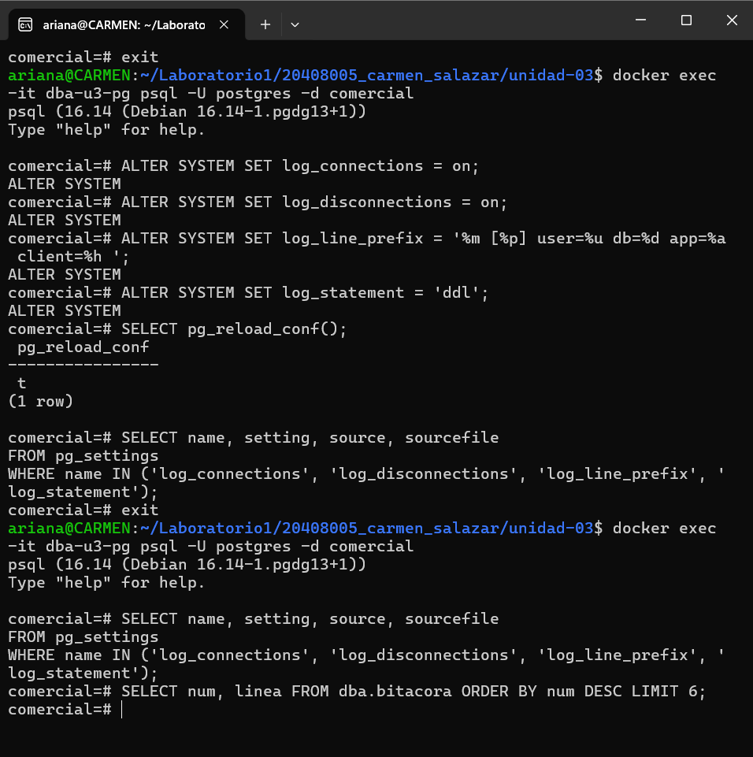
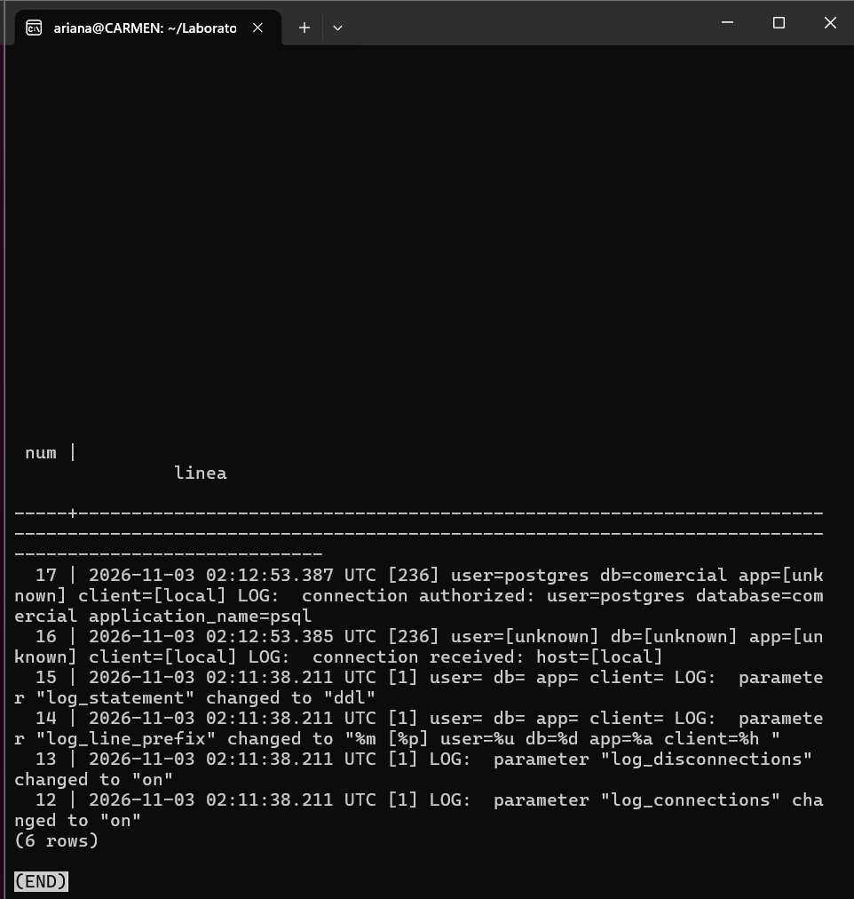

# Evidencia 04 — Configuración de la bitácora

**Estudiante:** Carmen Ariana Salazar Bojórquez 
**Actividad:** 4

## Comandos ejecutados
Ver `sql/02-configuracion-bitacora.sql`.

## Verificación del origen de los valores

## Últimas líneas de la bitácora

## Preguntas

**1. ¿Por qué el proceso que registra el cambio es el principal y no tu sesión?**
Mi sesión solo ejecutó `ALTER SYSTEM`, que escribe el valor en `postgresql.auto.conf`, y luego `pg_reload_conf()`, que envía una señal al proceso principal (postmaster, PID 1). Es ese proceso el que relee los archivos de configuración, aplica los nuevos valores y los propaga a los demás procesos. Por eso el mensaje `parameter ... changed to ...` lo escribe él y no aparece con mi usuario, base ni aplicación (el prefijo sale vacío: `user= db= app= client=`).

**2. ¿Qué pasaría si alguien ejecutara `ALTER SYSTEM SET log_statement = 'none'`? ¿Quedaría rastro?**
Sí quedaría rastro, pero con un límite. Mientras `log_statement` valga `ddl`, el propio `ALTER SYSTEM` se registra como sentencia, con usuario, aplicación e IP, porque se registra antes de que el cambio surta efecto. Después, al recargar, el proceso principal escribiría `parameter "log_statement" changed to "none"`. A partir de ese momento ya no se registrarían las sentencias DDL, así que el rastro se acaba justo ahí. El límite es que un superusuario puede apagar la bitácora y, si controla el servidor, alterar los archivos de bitácora; por eso conviene enviar las bitácoras a un sistema externo.

**3. ¿Por qué no se recomienda editar `postgresql.auto.conf` a mano?**
Porque el archivo lo administra PostgreSQL y lleva la advertencia de no editarlo manualmente. `ALTER SYSTEM` valida el parámetro y su valor, escribe el archivo de forma controlada y, con `log_statement = 'ddl'`, deja registrada la sentencia con quien la ejecutó. Una edición manual evita esa validación (un error de sintaxis puede impedir la recarga o el arranque), no deja constancia de la sentencia ni del usuario, y exige acceso al sistema de archivos del servidor. Solo quedaría el mensaje del proceso principal al recargar, sin saber quién hizo el cambio.
