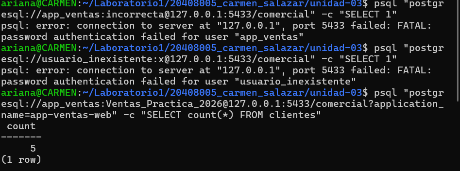
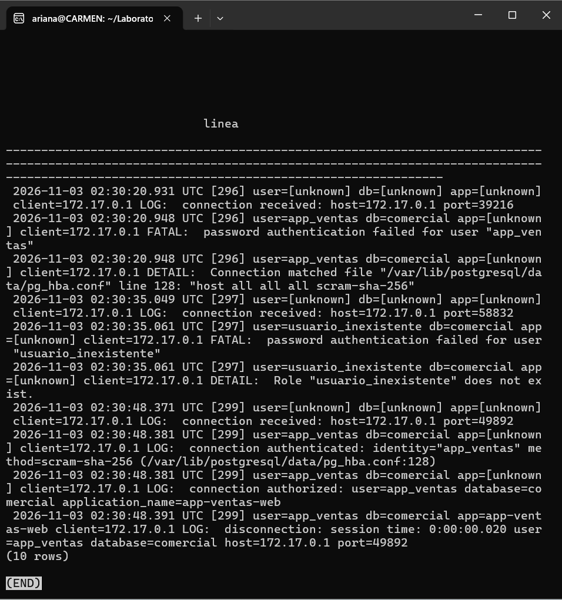
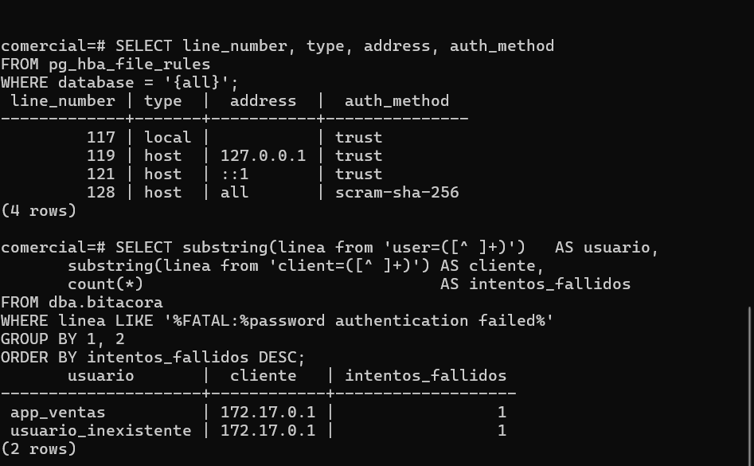

# Evidencia 05 — Accesos exitosos y fallidos

**Estudiante:** Carmen Ariana Salazar Bojórquez 
**Actividad:** 5

## Comandos ejecutados (sesión por red desde mi equipo, puerto 5433)
```bash
psql "postgresql://app_ventas:<REDACTED>@127.0.0.1:5433/comercial" -c "SELECT 1"
psql "postgresql://usuario_inexistente:<REDACTED>@127.0.0.1:5433/comercial" -c "SELECT 1"
psql "postgresql://app_ventas:<REDACTED>@127.0.0.1:5433/comercial?application_name=app-ventas-web" -c "SELECT count(*) FROM clientes"
```
**Resultado en el cliente:**


## Bitácora filtrada por IP del cliente




## Lectura de una línea campo por campo 

| Campo | Valor | Significado |
|---|---|---|
| Fecha y hora | 2026-11-03 02:30:20.948 UTC | Momento exacto del evento, con milisegundos y en UTC (`%m`). Equivale a las 19:30 del 2 de noviembre en mi zona (UTC-7), por lo que hay que convertirla al reconstruir la cronología. |
| PID | 296 | Identificador del proceso del servidor que atendió esa conexión (`%p`). Permite seguir todas las líneas de una misma sesión. |
| Usuario | app_ventas | Nombre de rol con el que se intentó entrar (`%u`). Lo declara el cliente, no prueba identidad. |
| Base de datos | comercial | Base a la que se intentó conectar (`%d`). |
| Aplicación | [unknown] | Nombre de aplicación (`%a`). Aún no está establecido porque la sesión no llegó a crearse. |
| Cliente | 172.17.0.1 | Dirección IP de origen de la conexión (`%h`). Es la IP de la red de Docker, porque me conecto desde mi equipo al puerto publicado. |
| Severidad | FATAL | Nivel del mensaje: el error terminó la sesión. |
| Mensaje | password authentication failed | Motivo del rechazo: la contraseña presentada no coincide. |
| Regla aplicada | pg_hba.conf línea <N> | Regla de `pg_hba.conf` que evaluó la conexión (viene en la línea `DETAIL`). |

##Consulta de intento fallidos por usuario 


## Preguntas

**1. La bitácora registra el usuario `app_ventas` en el intento fallido. ¿Eso prueba que la aplicación de ventas intentó entrar? ¿Qué prueba realmente?**
No lo prueba. El nombre de usuario lo declara el cliente al conectarse: cualquier persona que conozca o adivine el nombre `app_ventas` puede escribirlo con una contraseña equivocada. Lo que prueba la línea es que, en ese momento, alguien desde la IP indicada presentó ese nombre de usuario y no logró autenticarse. Ni siquiera dice que fue la aplicación, ni a qué persona corresponde. Es evidencia de un intento, no de identidad.

**2. ¿Qué información adicional registra PostgreSQL cuando el rol no existe? ¿Por qué aparece en la bitácora y no en el mensaje que recibe el cliente?**
Registra una línea `DETAIL: Role "usuario_inexistente" does not exist.`, que distingue "el rol no existe" de "la contraseña es incorrecta". Al cliente se le devuelve el mismo mensaje genérico en ambos casos (`password authentication failed`) para no revelar qué nombres de usuario son válidos; si el mensaje fuera distinto, un atacante podría enumerar usuarios. La bitácora solo la lee el administrador, así que ahí sí es útil el detalle para investigar.

**3. ¿Por qué `app=[unknown]` en el intento fallido, pero `app=app-ventas-web` en la desconexión?**
El nombre de aplicación solo se aplica a la sesión una vez que la conexión supera la autenticación. En el intento fallido la sesión nunca se estableció, así que `%a` no tiene valor y se muestra `[unknown]`. En el intento exitoso, la sesión completó el arranque y para la desconexión ya conocía `application_name`. Además, solo el tercer comando indicaba `application_name`; los dos fallidos no lo incluían. Esto confirma que `application_name` no sirve como prueba fuerte de identidad: lo declara el cliente y no existe cuando falla la autenticación.

**4. ¿Qué patrón de varias líneas te haría sospechar de un ataque de fuerza bruta? Escribe la consulta.**
Muchos `FATAL: password authentication failed` en poco tiempo desde la misma IP, ya sea contra un mismo usuario (adivinar su contraseña) o contra muchos nombres distintos (probar usuarios), especialmente si termina con una conexión exitosa justo después de la ráfaga. La consulta que cuenta los intentos fallidos por usuario y cliente es la de la sección anterior; para vigilar el patrón en el tiempo se agregaría la marca de tiempo (`min` y `max`) de cada grupo.
