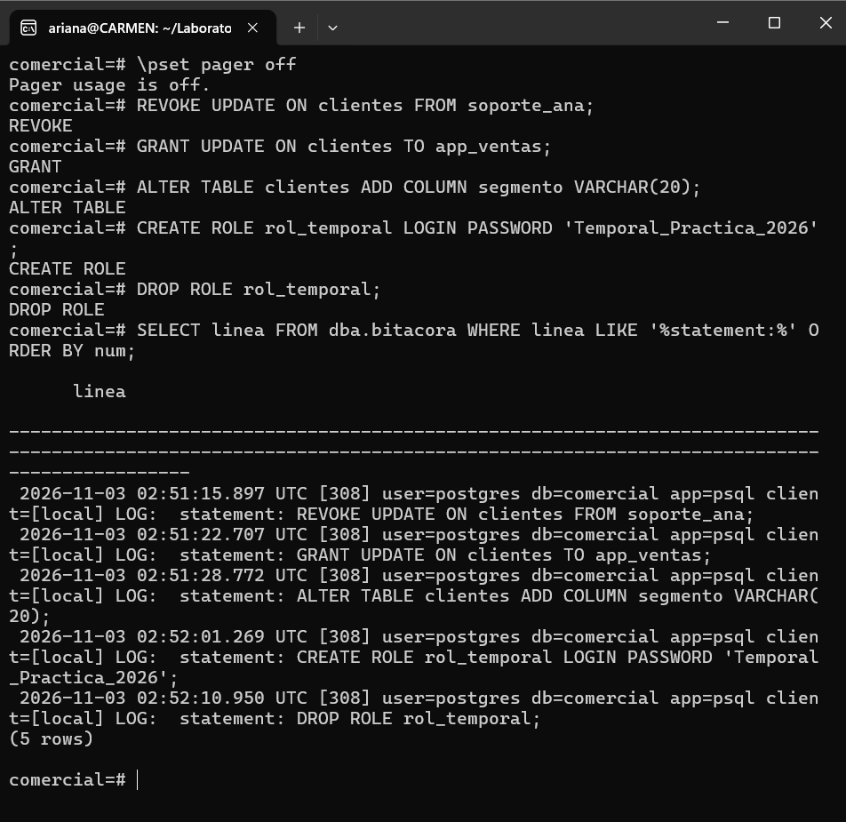

# Evidencia 06 — Cambios de privilegios y de estructura

**Estudiante:** Carmen Ariana Salazar Bojórquez 
**Actividad:** 6

## Comandos ejecutados

## Observación sobre el secreto
La sentencia `CREATE ROLE rol_temporal LOGIN PASSWORD '...'` quedó registrada con la contraseña en texto claro, y `DROP ROLE` no la borra de la bitácora. En cambio, `\password` calcula el resumen SCRAM en el cliente y solo envía ese resumen, por lo que ni siquiera el resumen en claro de la contraseña viaja en la sentencia.

## Preguntas

**1. ¿Qué tipo de evento es cada una de las tres primeras sentencias (privilegio o estructura)?**
- `REVOKE UPDATE ON clientes FROM soporte_ana`: cambio de **privilegios**.
- `GRANT UPDATE ON clientes TO app_ventas`: cambio de **privilegios**.
- `ALTER TABLE clientes ADD COLUMN segmento ...`: cambio de **estructura** (modifica la definición de la tabla).

**2. ¿Por qué `GRANT` y `REVOKE` quedan registrados con `log_statement = 'ddl'`?**
Porque `log_statement = 'ddl'` registra todas las sentencias de definición de datos (`CREATE`, `ALTER`, `DROP`) y también las de control de acceso, como `GRANT` y `REVOKE`, ya que modifican las definiciones de los objetos y sus permisos en el catálogo. Un cambio de privilegios es tan relevante para una auditoría como uno de estructura: determina quién puede leer o modificar los datos.

**3. Si la bitácora contiene contraseñas, ¿quién debería poder leerla? Relaciónalo con la gestión de secretos de la Unidad II.**
Solo personal autorizado y mínimo: el DBA o un rol de auditoría específico, y nunca la aplicación ni el personal de soporte. La bitácora pasa a ser tan sensible como un secreto, por lo que debe tener permisos restringidos, conservarse en un sistema protegido y retirar las contraseñas antes de compartirla. Se relaciona con la Unidad II porque los secretos no deben escribirse en sentencias, scripts ni repositorios: deben gestionarse con `\password`, `.pgpass` o un gestor de secretos, que es justo lo que evita que lleguen a la bitácora.
