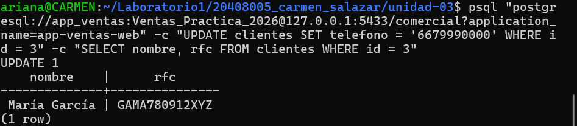
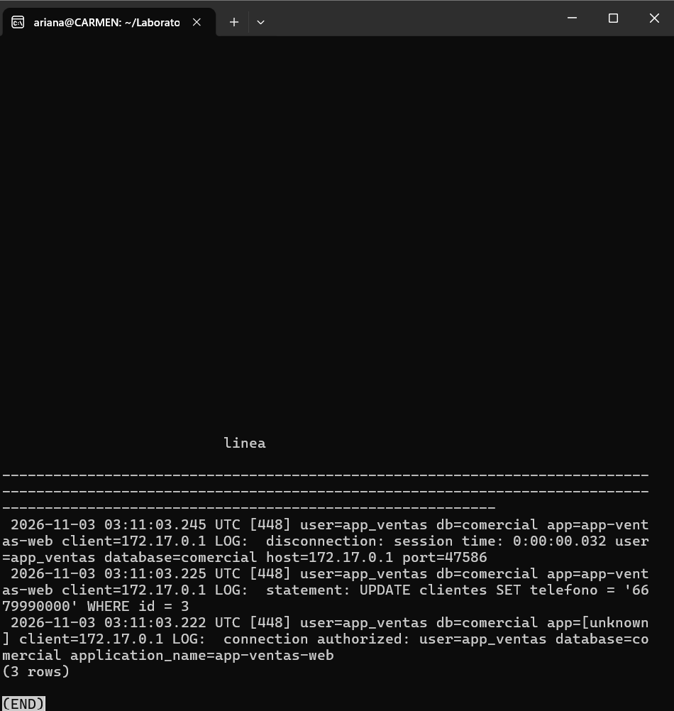
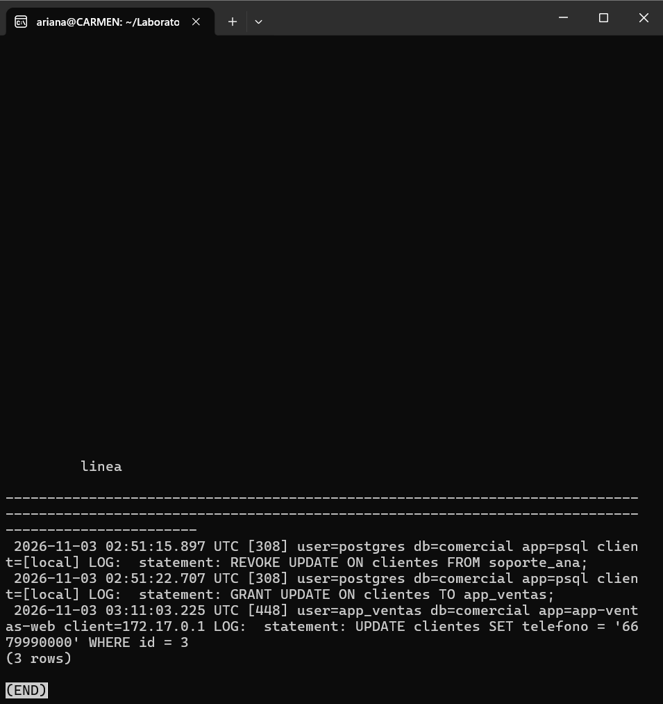
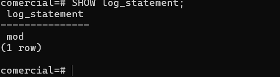

# Evidencia 07 — Modificaciones de datos: ddl frente a mod

**Estudiante:** Carmen Ariana Salazar Bojórquez 
**Actividad:** 7

## Parte 1 — UPDATE con log_statement = 'ddl'
**Comando (sesión por red como app_ventas):**


**Bitácora (últimas 3 líneas de app_ventas):**


**Búsqueda del UPDATE:**


**Observación:** aparecen la conexión y la desconexión de app_ventas, pero no el UPDATE.

## Parte 2 — Cambio a log_statement = 'mod'
**Comandos:**
```sql
ALTER SYSTEM SET log_statement = 'mod';
SELECT pg_reload_conf();
```
**Verificación (consulta posterior):**


## Preguntas

**1. ¿Qué nivel habría registrado la lectura del RFC? ¿Qué costo tendría en un servidor con miles de consultas por minuto?**
El nivel `all` (`log_statement = 'all'`), que registra todas las sentencias, incluidas las lecturas (`SELECT`). Con `mod` solo se registran las sentencias que modifican datos y las de definición (`ddl`), por eso el `SELECT nombre, rfc ...` no apareció.

En un servidor con miles de consultas por minuto tendría varios costos:
- **Volumen:** la bitácora crecería muy rápido, con una línea por cada consulta de todas las tablas, y no solo de las sensibles.
- **Almacenamiento y rotación:** los archivos se llenarían y rotarían con frecuencia (por tamaño o por día), con riesgo de perder evidencia antigua si no se exportan.
- **Rendimiento:** escribir tantas líneas añade carga de disco al servidor.
- **Ruido:** sería difícil encontrar los eventos relevantes entre miles de lecturas rutinarias.
- **Datos sensibles:** el texto de las consultas puede incluir datos personales o secretos, de modo que la bitácora se convertiría en un nuevo depósito de información sensible (como pasó con la contraseña en la Actividad 6).

**2. ¿Qué le falta a esta bitácora para revertir el cambio con certeza?**
Le falta el **valor anterior** del dato. La línea del `UPDATE` solo muestra la sentencia con el valor nuevo (`telefono = '6679990000'`), pero no dice qué teléfono tenía María García antes. Sin ese estado previo no se puede restaurar con certeza: habría que adivinarlo o buscar un respaldo. Tampoco existe un registro único que una, en el mismo evento, quién lo hizo, el valor anterior y el valor nuevo. La Parte B lo resuelve con una tabla de auditoría y un disparador que guarda `valores_antes` y `valores_despues` de cada cambio.
