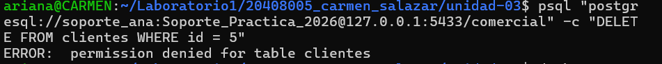
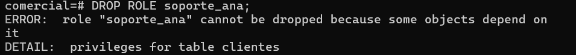
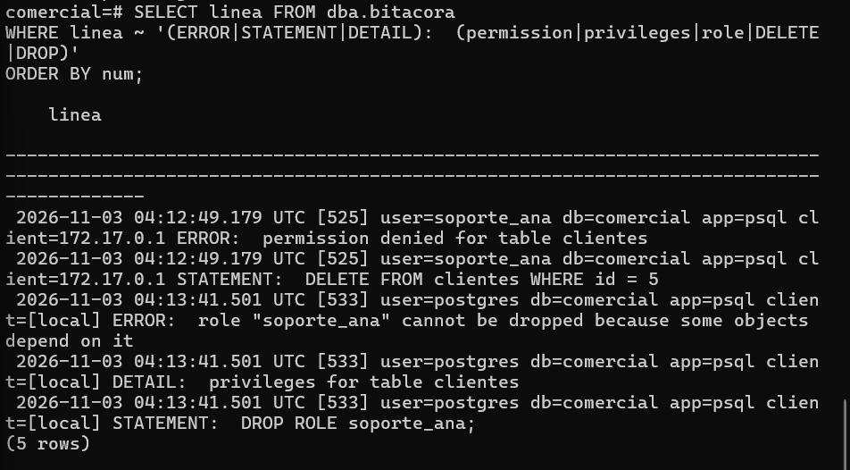
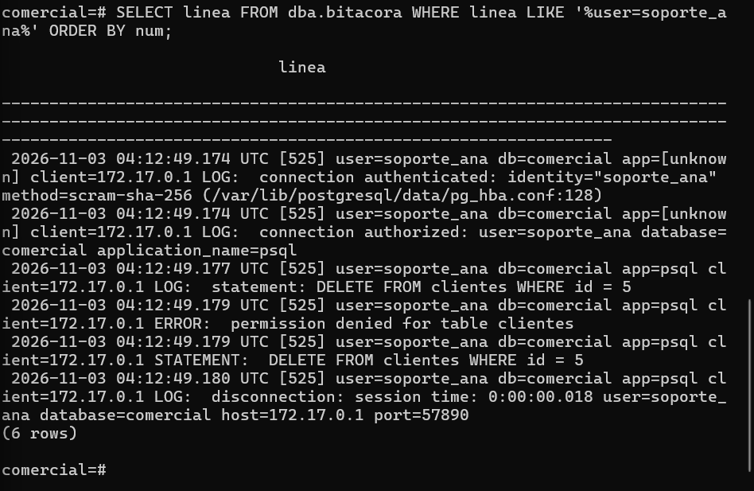

# Evidencia 08 — Errores y operaciones rechazadas

**Estudiante:** Carmen Ariana Salazar Bojórquez
**Actividad:** 8

## Intento de soporte_ana (sesión por red)
**Comando:**
```bash
psql "postgresql://soporte_ana:<REDACTED>@127.0.0.1:5433/comercial" -c "DELETE FROM clientes WHERE id = 5"
```
**Resultado:**


## Intento del administrador
**Comando:**
```sql
DROP ROLE soporte_ana;
```
**Resultado:**


## Bitácora filtrada
```sql
SELECT linea FROM dba.bitacora
WHERE linea ~ '(ERROR|STATEMENT|DETAIL):  (permission|privileges|role|DELETE|DROP)'
ORDER BY num;
```


## Todas las líneas de soporte_ana


## Preguntas

**1. ¿El intento de soporte_ana causó algún daño? ¿Por qué debe auditarse de todos modos?**
No causó daño: el `DELETE` fue rechazado con `permission denied for table clientes`, porque `soporte_ana` solo tiene `SELECT`, y la tabla conserva sus registros (`SELECT count(*) FROM clientes` sigue devolviendo 5). Debe auditarse de todos modos porque un intento fallido es una señal: puede indicar un error de operación, un permiso mal entendido, o un intento de abuso o una cuenta comprometida. Si no se registra, nadie se entera de que ocurrió y no hay forma de detectar patrones (por ejemplo, intentos repetidos) ni de demostrar después quién lo intentó, cuándo y desde dónde. La sentencia queda en la bitácora gracias a `log_min_error_statement = error`, con usuario, aplicación e IP en el prefijo.

**2. ¿Qué diferencia hay entre un error de autorización (esta actividad) y uno de autenticación (Actividad 5)?**
La autenticación responde "¿quién eres?": en la Actividad 5 la contraseña era incorrecta o el rol no existía, por lo que la sesión ni siquiera se creó (por eso `app=[unknown]` y mensaje `FATAL`). La autorización responde "¿qué puedes hacer?": aquí `soporte_ana` se autenticó correctamente, la sesión existe, y el servidor rechaza una operación concreta porque su rol no tiene el privilegio (`ERROR`, con la sentencia y `app=psql` en el registro). El primero indica un problema de identidad o de credenciales; el segundo, un intento de hacer algo fuera de los permisos concedidos, y ambos deben registrarse porque revelan riesgos distintos.

**3. ¿Qué indica el error de `DROP ROLE` sobre el orden correcto para dar de baja a un usuario?**
Indica que un rol no puede eliminarse mientras tenga objetos o privilegios que dependan de él (el `DETAIL` dice `privileges for table clientes`). El orden correcto es primero revocar los privilegios del rol (o reasignar y eliminar los objetos que posee, con `REASSIGN OWNED` y `DROP OWNED`) y solo después ejecutar `DROP ROLE`. Además, la baja debe quedar documentada dentro del ciclo de vida de las cuentas (Unidad II), de modo que no queden permisos huérfanos y que la bitácora conserve evidencia de la baja.
