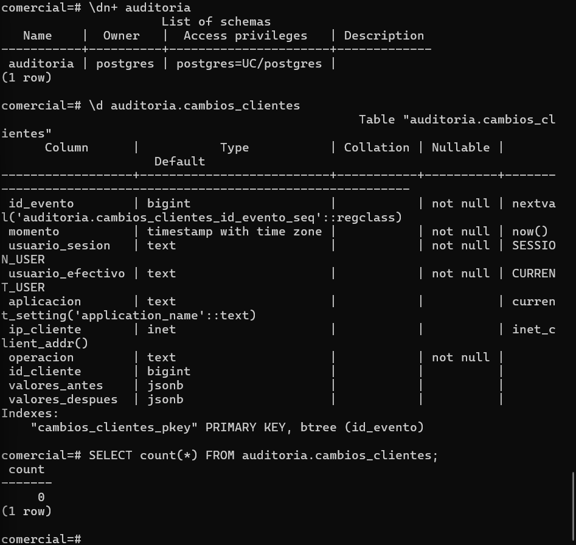

# Evidencia 10 — Diseño del registro de auditoría

**Estudiante:** Carmen Ariana Salazar Bojórquez
**Actividad:** 10
**Requerimiento:** R1. Todo cambio en `clientes` debe conservar el valor anterior, el valor nuevo, el usuario, la aplicación, la IP y el momento.

## Diseño de campos
| Campo | Tipo | ¿Qué pregunta responde? | ¿Puede ser nulo? ¿Por qué? |
|---|---|---|---|
| id_evento | BIGSERIAL | Ninguna directa: identifica y ordena cada evento y permite citarlo en el informe. | No. Es la clave primaria. |
| momento | TIMESTAMPTZ | ¿Cuándo? | No. Todo evento debe tener hora; sin ella no entra en la cronología. |
| usuario_sesion | TEXT | ¿Quién? Es el rol con el que se autenticó la sesión (`session_user`). | No. Siempre existe una sesión autenticada. |
| usuario_efectivo | TEXT | ¿Quién? (complementa). Es el rol con el que corre el código (`current_user`); con `SECURITY DEFINER` es el dueño de la función. | No. Siempre hay un rol efectivo. |
| aplicacion | TEXT | ¿Desde qué aplicación? Es el `application_name` que declara el cliente. | Sí, en la práctica. El cliente puede no declararlo, y no es evidencia fuerte porque lo declara él mismo. |
| ip_cliente | INET | ¿Desde qué equipo? | Sí. En conexiones por socket local (como el administrador en `docker exec`) no hay IP. |
| operacion | TEXT | ¿Qué se hizo? (INSERT, UPDATE o DELETE). Apoya la interpretación de las demás respuestas. | No. Sin la operación el evento no se entiende. |
| id_cliente | BIGINT | ¿Sobre qué registro? Permite buscar el historial de un cliente (por ejemplo, id = 3). | Sí en el DDL, pero el disparador siempre lo llena. Se deja sin restricción para que la auditoría no falle si cambia la estructura. |
| valores_antes | JSONB | ¿Qué valor tenía antes? | Sí. En un INSERT no existía estado anterior. |
| valores_despues | JSONB | ¿Qué valor tiene ahora? | Sí. En un DELETE ya no hay estado posterior. |

## Verificación

## Preguntas

**1. ¿Por qué `momento` usa TIMESTAMPTZ y no TIMESTAMP?**
Porque un `TIMESTAMP` solo guarda la fecha y la hora "a secas", sin decir en qué zona horaria están, y eso se presta a confusiones. En este laboratorio ya vimos que la bitácora del servidor está en UTC, mientras que mi equipo está en UTC-7. Con `TIMESTAMPTZ` PostgreSQL guarda el instante exacto y lo puede mostrar en la zona que se pida, así que puedo comparar un evento de la tabla de auditoría con una línea de la bitácora sin hacer cuentas a mano. Si alguien revisa esto desde otra zona, o si el servidor se mueve a otra región, la cronología sigue siendo correcta. Con `TIMESTAMP` se corre el riesgo de ordenar mal los eventos o de atribuir un cambio al turno equivocado.

**2. ¿Por qué se guarda el registro completo en JSONB y no solo la columna que cambió?**
Porque así la auditoría conserva el estado completo de la fila antes y después del cambio, y no depende de adivinar qué campo importaba. Si solo guardara la columna modificada, tendría que crear una columna de auditoría por cada campo de `clientes`, y cualquier cambio en la tabla rompería el diseño.Además, un solo `UPDATE` puede modificar varios campos a la vez, y con el documento completo puedo comparar `valores_antes` con `valores_despues` y ver exactamente qué cambió, o restaurar la fila completa si hace falta.

**3. La tabla de auditoría también contendrá RFC. ¿Qué implica eso para su clasificación y su control de acceso?**
Implica que esta tabla es tan sensible como `clientes`, o incluso más, porque no solo guarda el RFC actual sino también todos los valores anteriores, y hasta los de clientes que ya fueron borrados. Por eso debe clasificarse con el mismo nivel de datos personales que la tabla original, o uno superior. En cuanto al acceso, solo debería poder leerla el DBA o un rol de auditoría, y no la aplicación ni el personal de soporte. Para eso se creó en un esquema aparte y se le quitó el acceso a `PUBLIC` con `REVOKE ALL`: ni siquiera `app_ventas` puede entrar al esquema `auditoria`. También hay que tener cuidado al exportarla o subirla a un repositorio, y por eso la guía pide incluir solo las filas necesarias como evidencia.
