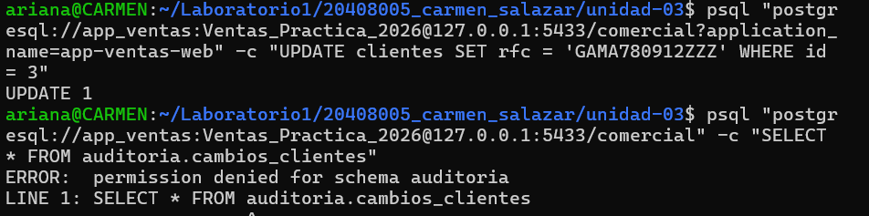
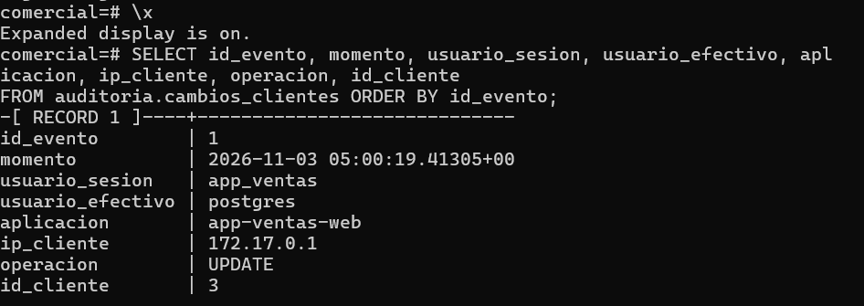

# Evidencia 12 — El incidente auditado

**Estudiante:** Carmen Ariana Salazar Bojórquez 
**Actividad:** 12

## Comandos ejecutados (sesión por red como app_ventas)
```bash
psql "postgresql://app_ventas:<REDACTED>@127.0.0.1:5433/comercial?application_name=app-ventas-web" -c "UPDATE clientes SET rfc = 'GAMA780912ZZZ' WHERE id = 3"
psql "postgresql://app_ventas:<REDACTED>@127.0.0.1:5433/comercial" -c "SELECT * FROM auditoria.cambios_clientes"
```

**Resultado:**


## Registro de auditoría (sesión de administrador)
**Comando:**
```sql
\x
SELECT id_evento, momento, usuario_sesion, usuario_efectivo, aplicacion, ip_cliente, operacion, id_cliente
FROM auditoria.cambios_clientes ORDER BY id_evento;
\x
```



## Preguntas

**1. Compara tu hipótesis de la Actividad 11 con este resultado.**
Mi hipótesis era que, si la función no fuera `SECURITY DEFINER`, el disparador correría con los privilegios de quien hace el `UPDATE`. Como `app_ventas` no tiene acceso al esquema `auditoria` (se le quitó a `PUBLIC` en la Actividad 10), el `INSERT` en la tabla de auditoría habría fallado con `permission denied for schema auditoria` y, al fallar dentro del disparador, se habría cancelado también el `UPDATE` original. El resultado confirmó la otra cara de esa idea: el `UPDATE` salió bien (`UPDATE 1`) y quedó el registro en la auditoría, aunque `app_ventas` no puede ni leer ese esquema. Lo que lo explica es el campo `usuario_efectivo = postgres`: dentro de la función, `current_user` es el dueño de la función, así que el `INSERT` se hizo con sus privilegios. Y por eso la auditoría guarda también `usuario_sesion` (`session_user`), que sigue siendo `app_ventas`; si solo usara `current_user`, todos los cambios parecerían hechos por `postgres`.

**2. Escribe la sentencia UPDATE que restauraría el valor anterior.**
```sql
UPDATE clientes SET rfc = 'GAMA780912XYZ' WHERE id = 3;
```
Es el valor que aparece en la columna `antes` de la consulta campo por campo. No la ejecuté, porque hacerlo generaría un nuevo registro en la auditoría; además, una restauración real debería quedar autorizada y documentada.

**3. ¿Qué columna conserva más valor para una investigación: aplicacion o ip_cliente? ¿Cuál puede falsificar el cliente con más facilidad?**
Para una investigación vale más `ip_cliente`, porque la determina el servidor a partir de la conexión de red y no depende de lo que diga el cliente. Permite acotar desde qué equipo o red se hizo el cambio y cruzarlo con otras fuentes, como la bitácora. `aplicacion`, en cambio, es el `application_name`, que el propio cliente escribe en la cadena de conexión: yo mismo lo cambié a mi gusto en las pruebas, y cualquiera puede ponerle el nombre de una aplicación legítima. Sirve para distinguir aplicaciones, pero no como evidencia fuerte de identidad. Aun así, la IP tiene límites: en mi laboratorio aparece la de la red de Docker (`172.17.0.1`) y no la de un equipo concreto, y detrás de un proxy o una conexión compartida puede representar a muchos usuarios. Por eso conviene combinar ambos datos con el usuario de sesión y la bitácora.
