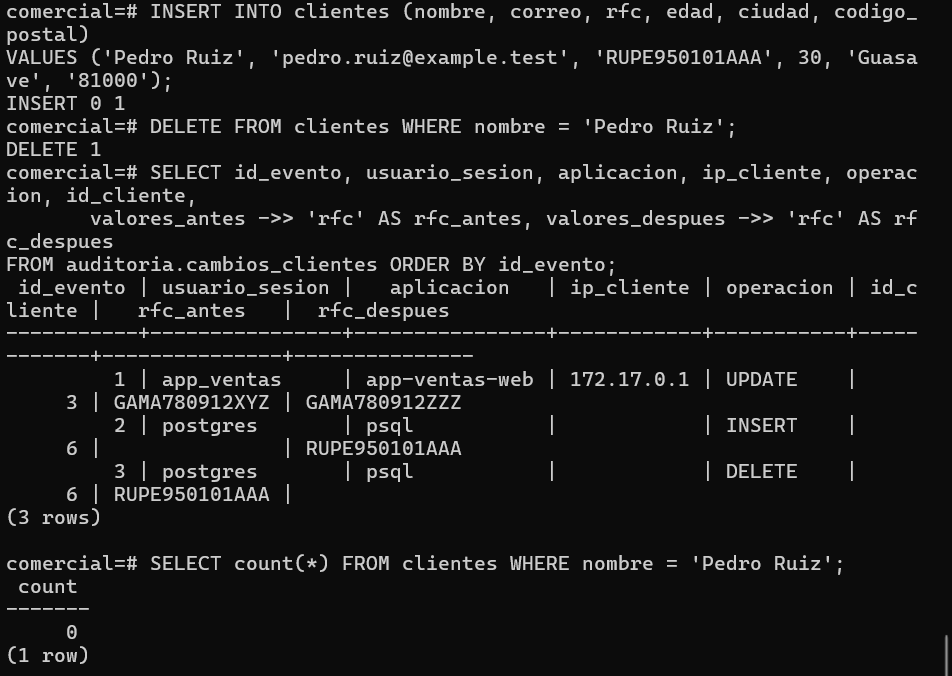
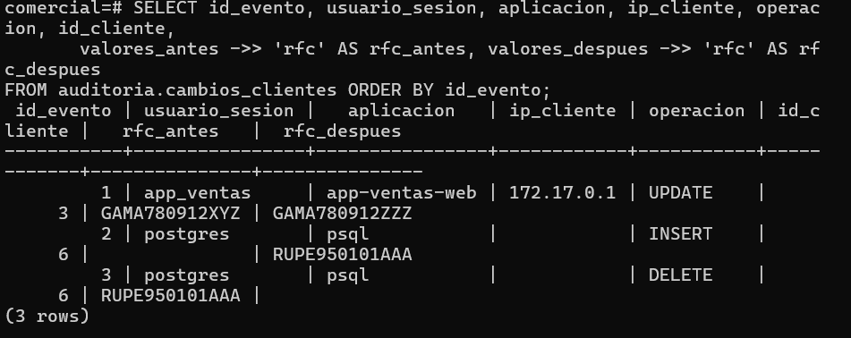

# Evidencia 12 — Altas y bajas

**Estudiante:** Carmen Ariana Salazar Bojórquez
**Actividad:** 13

## Comandos ejecutados (sesión de administrador)
```sql
INSERT INTO clientes (nombre, correo, rfc, edad, ciudad, codigo_postal)
VALUES ('Pedro Ruiz', 'pedro.ruiz@example.test', 'RUPE950101AAA', 30, 'Guasave', '81000');
DELETE FROM clientes WHERE nombre = 'Pedro Ruiz';
```

## Consulta de la auditoría
```sql
SELECT id_evento, usuario_sesion, aplicacion, ip_cliente, operacion, id_cliente,
       valores_antes ->> 'rfc' AS rfc_antes, valores_despues ->> 'rfc' AS rfc_despues
FROM auditoria.cambios_clientes ORDER BY id_evento;
```


## Preguntas

**1. El cliente Pedro Ruiz ya no existe en clientes. ¿Dónde queda evidencia de que existió y de sus datos?**
En la tabla de auditoría. El evento 3 (`DELETE`) guarda en `valores_antes` el documento JSON completo de la fila tal como estaba antes de borrarla: nombre, correo, RFC, edad, ciudad y código postal. El evento 2 (`INSERT`) también guarda esos datos en `valores_despues`, así que queda registrado cuándo se dio de alta y cuándo se dio de baja. Además, como `log_statement` estaba en `mod`, la bitácora del servidor conserva las sentencias `INSERT` y `DELETE`, con usuario y hora, aunque no los valores completos. La auditoría dice qué datos tenía, y la bitácora confirma qué sentencias se ejecutaron.

**2. ¿Por qué ip_cliente está vacía en los eventos 2 y 3?**
Porque esas operaciones las hice desde la sesión de administrador, que se abre por el socket local del propio servidor (`docker exec ... psql -U postgres`) y no por la red. Una conexión por socket local no tiene dirección IP de cliente, así que `inet_client_addr()` devuelve nulo y la columna queda vacía. En la bitácora esa misma sesión aparece como `client=[local]`. En el evento 1, en cambio, sí hay IP porque `app_ventas` se conectó por red. Es una limitación a tener en cuenta: los cambios hechos localmente por un administrador no dejan la IP como pista, y solo queda `usuario_sesion` y `aplicacion`.

**3. La política de retención de la Unidad II pedía eliminar datos cuando ya no fueran necesarios. ¿Qué conflicto aparece? ¿Quién debe resolverlo?**
Aparece un conflicto entre dos obligaciones legítimas. Por un lado, la política de retención y el principio de minimización piden eliminar los datos personales cuando ya no se necesitan, y Pedro Ruiz se borró de `clientes`. Por otro lado, la auditoría necesita conservar la evidencia de los cambios, y para eso guarda el registro completo, incluido el RFC de Pedro, en `valores_antes` sin fecha de caducidad. Así, el dato que se "eliminó" sigue existiendo en otra tabla. Esa decisión no le corresponde al DBA por sí solo, porque él opera la base pero no define las políticas. Debe resolverla quien responde por los datos y el cumplimiento (el responsable de los datos junto con el área legal o de cumplimiento), definiendo por cuánto tiempo se conserva la auditoría, con qué justificación y quién autoriza su depuración. Y esa depuración también debería quedar registrada.
