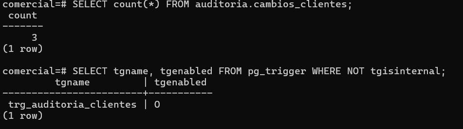
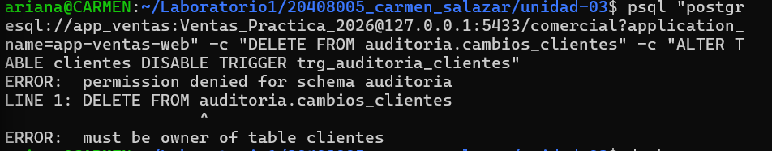
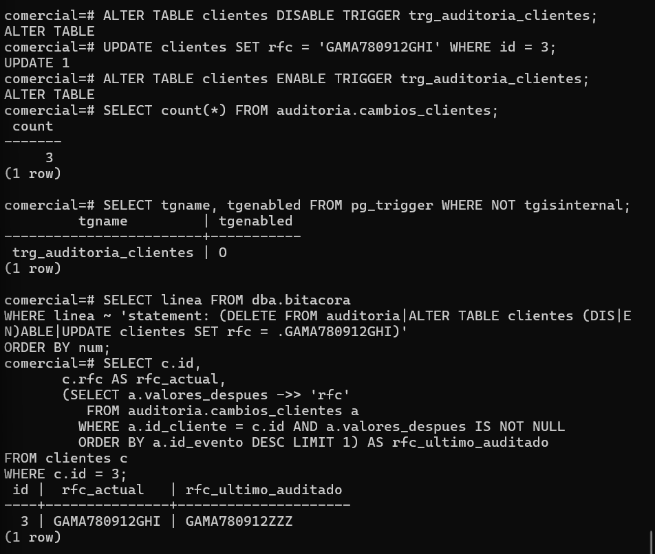

# Evidencia 13 — Intento de manipular la auditoría

**Estudiante:** Carmen Ariana Salazar Bojórquez
**Actividad:** 14

## Estado inicial


## Intento de la aplicación (sesión por red como app_ventas)
**Comando:**
```bash
psql "postgresql://app_ventas:<REDACTED>@127.0.0.1:5433/comercial?application_name=app-ventas-web" -c "DELETE FROM auditoria.cambios_clientes" -c "ALTER TABLE clientes DISABLE TRIGGER trg_auditoria_clientes"
```
**Resultado:**


## Manipulación desde la cuenta de administrador
**Comandos:**
```sql
ALTER TABLE clientes DISABLE TRIGGER trg_auditoria_clientes;
UPDATE clientes SET rfc = 'GAMA780912GHI' WHERE id = 3;
ALTER TABLE clientes ENABLE TRIGGER trg_auditoria_clientes;
SELECT count(*) FROM auditoria.cambios_clientes;
```

## Preguntas

**1. ¿Qué evidencia permite detectar que hubo un cambio sin auditar?**
Lo que lo delata es que dos fuentes que deberían contar la misma historia no coinciden. En la bitácora del servidor aparece el `UPDATE` de `postgres` sobre el RFC del cliente 3, y justo antes y después las sentencias `ALTER TABLE clientes DISABLE TRIGGER` y `ENABLE TRIGGER`. Pero en la tabla de auditoría no hay ningún evento nuevo para ese cambio: el conteo siguió en 3. Además, al comparar el RFC actual de `clientes` (`GAMA780912GHI`) con el último valor registrado en la auditoría (`GAMA780912ZZZ`), no coinciden, y esa diferencia solo se explica con un cambio que no pasó por el disparador. La bitácora no puede decir cuál fue el valor anterior, pero sí deja constancia de que el mecanismo se desactivó, y por eso las dos fuentes se complementan.

**2. ¿Qué control administrativo (no técnico) reduciría este riesgo?**
Un procedimiento de gestión de cambios: que desactivar un mecanismo de control como el disparador requiera una solicitud documentada y autorizada por alguien distinto de quien la ejecuta, con un motivo y una ventana de tiempo definidos. A eso se suma la revisión periódica de la bitácora por una persona o área independiente del DBA, que compare las sentencias registradas con la auditoría, y que el uso de la cuenta de superusuario esté justificado y documentado. Son controles de procedimiento: no impiden técnicamente que el administrador lo haga, pero hacen que hacerlo sin autorización sea una falta detectable y atribuible.

**3. Relaciona esta actividad con el principio de separación de funciones de la Unidad II.**
Esta actividad muestra lo que pasa cuando no hay separación: el administrador operó la base, desactivó el control, modificó el dato y volvió a activar el disparador, y nadie más intervino. En cambio, la aplicación, que tiene funciones limitadas, no pudo borrar la auditoría ni tocar el disparador (`permission denied` y `must be owner`). El principio dice que quien opera el sistema no debe ser también quien lo audita ni quien custodia la evidencia. Por eso conviene enviar la bitácora a un sistema externo administrado por otra área, y que quien revisa la auditoría no sea quien tiene control total del servidor. Ningún mecanismo dentro del propio servidor protege contra un administrador con control total; lo que protege es separar las funciones.
