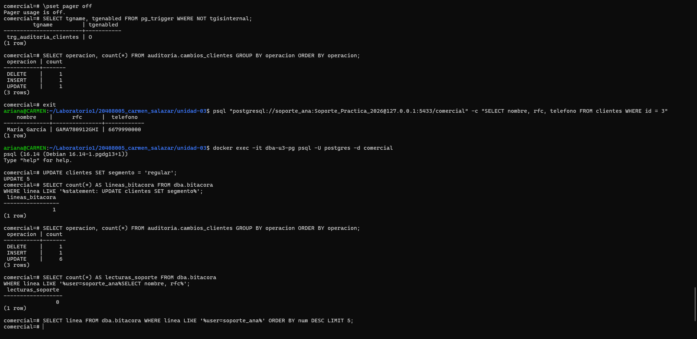

# Evidencia 14 — Límites: lecturas y volumen

**Estudiante:** Carmen Ariana Salazar Bojórquez
**Actividad:** 15

## Comandos

## Preguntas

**1. Si clientes tuviera un millón de registros, ¿qué ocurriría con la auditoría tras un UPDATE sin WHERE?**
La auditoría se llenaría de golpe. El disparador es `FOR EACH ROW`, así que se ejecuta una vez por cada fila modificada: con 5 filas me dio 5 registros de auditoría, y con un millón serían un millón de registros nuevos, cada uno con dos documentos JSON completos (`valores_antes` y `valores_despues`). La tabla de auditoría crecería muchísimo en un solo instante, ocuparía mucho disco y se volvería lenta de consultar. Además, el `UPDATE` original tardaría mucho más de lo normal, porque cada fila obliga a hacer un `INSERT` extra dentro de la misma transacción, y eso mantendría bloqueos y generaría mucho tráfico de escritura. Y el contraste con la bitácora es notable: el mismo cambio dejaría una sola línea en la bitácora (`statement: UPDATE clientes SET segmento...`) frente a un millón de filas en la auditoría. La bitácora dice qué se ejecutó y la auditoría detalla cada fila, pero esa riqueza tiene un costo.

**2. Propón quién podría autorizar la depuración de auditoria.cambios_clientes.**
No debería decidirlo el DBA por su cuenta. Propongo que lo autorice el responsable de los datos (el dueño de la información de clientes) junto con el área legal o de cumplimiento, que son quienes conocen los plazos de retención que exige la normativa y la política de la organización. El DBA solo la ejecutaría, y de preferencia con la participación de otra persona (control compartido) para que no dependa de una sola. La autorización debería quedar por escrito, con el periodo que se va a depurar y el motivo, y la depuración misma debería quedar registrada. Así se respeta la política de retención de la Unidad II sin que se pierda evidencia que todavía hace falta.

**3. ¿Por qué log_statement = 'all' puede convertir la bitácora en un nuevo depósito de datos sensibles?**
Porque con `all` el servidor escribe el texto completo de cada sentencia, y ese texto incluye los valores que se manejan: el RFC en un `WHERE`, los datos de un `INSERT`, correos, teléfonos y hasta contraseñas, como vimos en la Actividad 6 con `CREATE ROLE ... PASSWORD`. Además registraría las lecturas de todas las tablas, no solo las de datos sensibles, así que la bitácora acumularía una copia de mucha información personal. El problema es que esa copia vive en un archivo de texto plano, con permisos y controles distintos a los de las tablas, que se puede copiar, exportar o compartir sin darse cuenta, y que además se conserva por la rotación y los respaldos. Es decir, se crearía un segundo lugar donde están los datos sensibles, con menos protección que el original, y habría que clasificarlo, restringir su acceso y limpiarlo antes de compartirlo.
